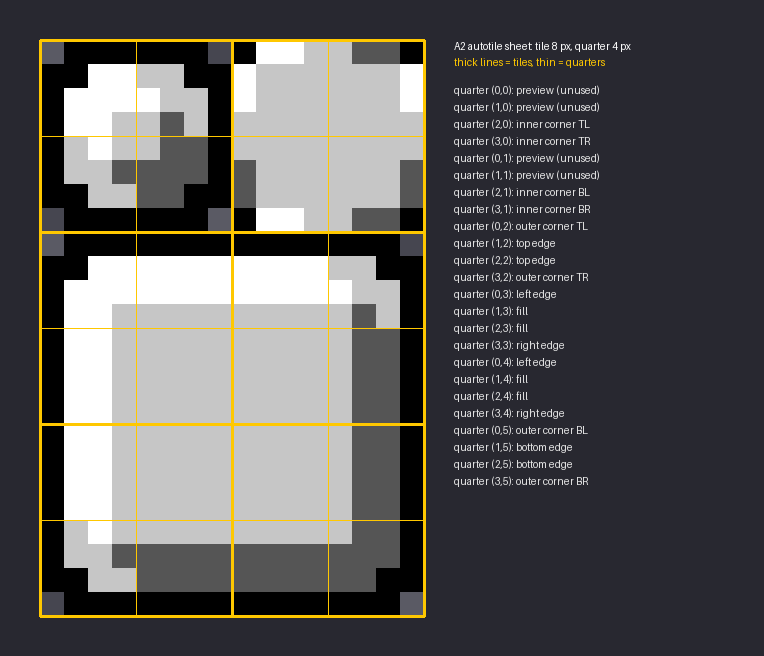

# Glyphwork skin format

The easiest way to make one is the [skin editor](https://flyingfinger1.github.io/Glyphwork/)
([guide](skin-editor.md)); this page describes the format itself.

A **theme** (skin) is a folder in `plugins/Glyphwork/themes/<id>/`. Select it with `theme: <id>` in
`config.yml`. On first start the built-in skin is exported to `themes/vanilla/`; copy that folder
as a starting point.

```
themes/my_skin/
  theme.json
  panel.png
  button.png
  slot.png
```

`theme.json`:

```json
{
  "name": "My Skin",
  "tileSize": 8,
  "frames": { "panel": "panel.png", "button": "button.png", "slot": "slot.png" }
}
```

- `tileSize`: even, at least 8. All frames of a theme share it.
- Required frames: `panel`, `button`, `slot`. More frames may be added; they become available to
  scenes under their key.
- Buttons are drawn **tinted**: the scene's color multiplies the texture. Keep `button.png` light
  gray so any tint works; colors in the PNG multiply with the tint.

## Frame PNG: A2 autotile sheet

Each frame is a sheet of `2 x 3` tiles (`16 x 24` px for tile size 8), split into quarters
(`tileSize / 2`). Glyphwork builds all 47 tiles a frame can need (outer corners, edges, fill, inner
corners of L/T shapes) from these quarters, so any shape of cells joins seamlessly.



| Quarter (col,row) | Used for |
|---|---|
| (0..1, 0..1) | preview of a single tile, not used for rendering |
| (2,0) (3,0) (2,1) (3,1) | inner corners: top-left, top-right, bottom-left, bottom-right |
| (0..3, 2..5) | a 2x2-tile frame: outer corners, edges between them, fill in the middle |

How a quadrant of a cell picks its quarter: look at the horizontal neighbour (h), vertical
neighbour (v) and diagonal neighbour (d) on that quadrant's side.

| h | v | d | quarter |
|---|---|---|---|
| no | no | - | outer corner |
| yes | no | - | top/bottom edge |
| no | yes | - | left/right edge |
| yes | yes | no | inner corner |
| yes | yes | yes | fill |

Rules for drawing:
- Transparent pixels are allowed (rounded corners, see-through frames).
- A tile whose rightmost column is fully transparent has a smaller advance; Glyphwork positions
  every tile absolutely, so this is fine.
- Glyphs cannot scale; draw at 1:1 GUI pixels.
